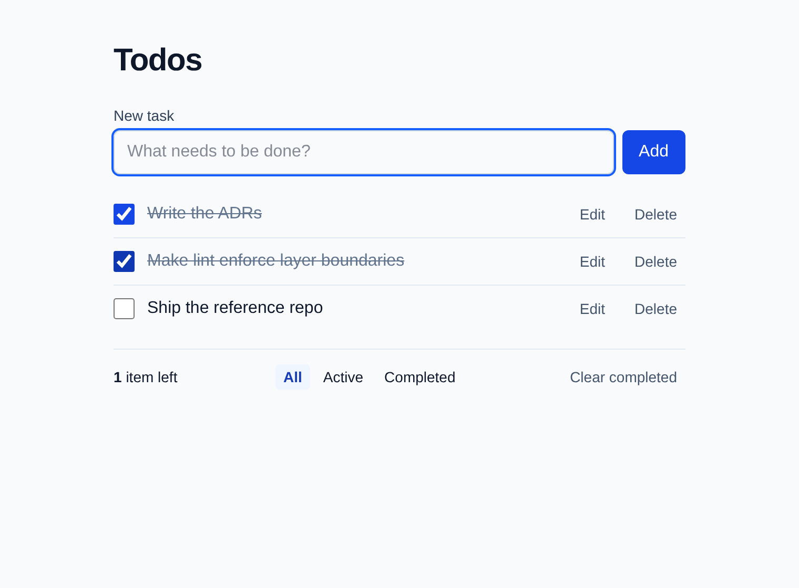

# todo-reference

[](https://github.com/ogbofjnr/todo-reference/actions/workflows/ci.yml)

A small Todo app built as a reference for **production-grade React architecture**: strict
types, machine-enforced rules, tests at every level, and a written reason for every tool and
layer, including the ones left out.



**Features:** add (validated: non-empty, ≤200 chars), complete, inline edit, delete, clear
completed. All / Active / Completed filters stored in the URL. "N items left" counter. Persistence
behind a repository interface (localStorage today). Optimistic updates with rollback on error.
Loading, error and empty states. Keyboard and screen-reader support.

## Stack

React 19.3 (+ React Compiler) · TypeScript 6 (strict) · Vite 8 · Tailwind CSS 4 · zod 4 ·
Vitest 5 + Testing Library · Playwright + axe-core · ESLint 10 (type-aware) + Prettier · knip ·
lefthook + commitlint · pnpm 12 · Node 26 LTS.

No state library, no router, no MSW. [ADR 0013](docs/adr/0013-deliberately-excluded.md)
explains why, and when each would be added.

## Getting started

Requires Node 26 (`nvm use`) and pnpm 12 (`npm i -g pnpm@12`).

```bash
pnpm install
pnpm dev
```

Optional: copy `.env.example` to `.env.local` and set `VITE_SIMULATED_LATENCY_MS=800` to see the
loading and optimistic states, or `VITE_SIMULATED_FAILURE_RATE=0.5` to see rollback.

## Scripts

| Script                                       | What it does                                                  |
| -------------------------------------------- | ------------------------------------------------------------- |
| `pnpm dev` / `build` / `preview`             | Vite dev server / production build / serve the build          |
| `pnpm typecheck`                             | `tsc` for app and node configs                                |
| `pnpm lint` / `lint:fix`                     | ESLint, zero warnings allowed                                 |
| `pnpm format` / `format:check`               | Prettier                                                      |
| `pnpm knip`                                  | Unused files, exports, dependencies                           |
| `pnpm test` / `test:watch` / `test:coverage` | Vitest unit and integration tests (coverage ≥ 90%)            |
| `pnpm test:e2e`                              | Builds, then runs Playwright against the production build     |
| `pnpm check`                                 | **Everything above, same as CI.** Must be green before merge. |

E2E needs a browser once: `pnpm exec playwright install chromium`.

## Structure

```
src/
  app/                 composition root: main.tsx, App.tsx, styles.css
  features/todos/      the feature; index.ts is its public API
    domain/            pure TS: types, validation, reducer, filters (unit-tested)
    data/              TodoRepository + localStorage impl + simulated-network decorator
    model/             hooks: useTodos (optimistic CRUD), useTodoFilter (URL), DI context
    ui/                components + integration tests
  shared/              config/env.ts, lib/use-search-param.ts, ui/ErrorBoundary.tsx
e2e/                   Playwright specs
docs/                  architecture, research, ADRs
```

`app → features → shared`. Features never import each other. Lint enforces both.

## Documentation

- [docs/ARCHITECTURE.md](docs/ARCHITECTURE.md): layers, data flow (diagrams), state ownership,
  accessibility, how to add a feature or replace the storage
- [docs/adr/](docs/adr/): every decision with alternatives
- [docs/RESEARCH.md](docs/RESEARCH.md): ecosystem survey behind the decisions (versions, sources)
- [CLAUDE.md](CLAUDE.md): rules for AI agents (and humans in a hurry)

## License

MIT
