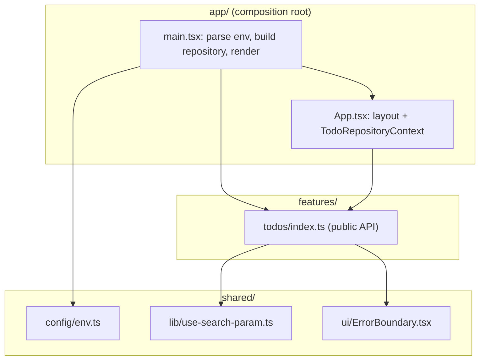
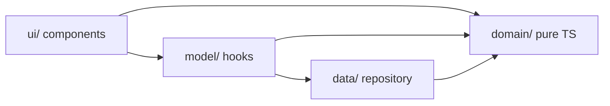
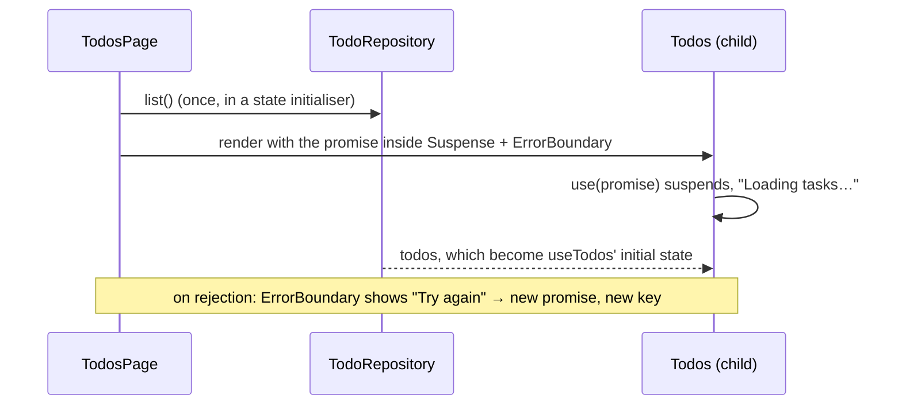
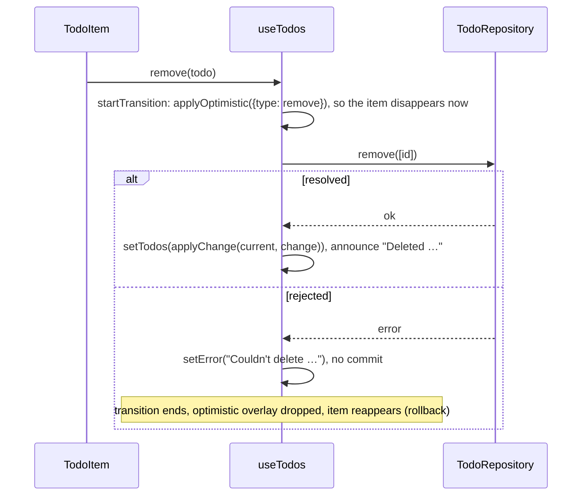

# Architecture

How the code is organised, how data flows, and how to extend it. The reasons behind each
choice are in the [ADRs](adr/).

## Layers



| Layer             | May import                                    | Contains                                                    |
| ----------------- | --------------------------------------------- | ----------------------------------------------------------- |
| `app`             | `app`, any feature's **public API**, `shared` | Wiring: env, implementations, providers, layout, global CSS |
| `features/<name>` | itself, `shared`                              | Everything a product feature needs: domain, data, model, UI |
| `shared`          | `shared`                                      | Feature-agnostic building blocks                            |

These rules are lint errors, not conventions (`eslint.config.ts`, _Architecture_ block):

- Imports between different features fail (`boundaries/dependencies`).
- `shared` importing a feature or `app` fails (`boundaries/dependencies`).
- Importing past a feature's `index.ts` (`@/features/todos/ui/...`) fails (`no-restricted-imports`).
- A file under `src/` outside the known layers fails (`boundaries/no-unknown-files`).

### Inside a feature



- `domain/`: types and pure functions (validation, `applyChange` reducer, filters, counts). No
  React, no I/O. Unit-tested.
- `data/`: the `TodoRepository` interface and its implementations
  (`createLocalStorageTodoRepository`, `withSimulatedNetwork` decorator).
- `model/`: React hooks that own state. `useTodos` handles optimistic CRUD, `useTodoFilter`
  handles URL state, and `TodoRepositoryContext` is the DI seam.
- `ui/`: components. `TodosPage` handles loading and error boundaries and wires the model to
  presentational components (`NewTodoForm`, `TodoList`, `TodoItem`, `TodoEditForm`,
  `TodoFooter`), which
  receive data and callbacks as props.

## Where state lives

| State                                      | Owner                              | Source of truth                                                     |
| ------------------------------------------ | ---------------------------------- | ------------------------------------------------------------------- |
| Todos (persisted)                          | `useTodos`                         | The repository. React holds confirmed state plus optimistic overlay |
| Filter                                     | `useTodoFilter` → `useSearchParam` | The URL query string (`?filter=active`)                             |
| Input drafts, edit mode, validation errors | The component that renders them    | Local `useState`                                                    |
| Announcements and errors                   | `useTodos`                         | Local state rendered into `role="status"` / `role="alert"`          |

## Data flow

### Loading



### A mutation (e.g. delete)



The same pure `applyChange` reducer is used for the optimistic overlay, the confirmed state and
inside the localStorage implementation, so all three agree by construction.

## Accessibility

- Semantic elements: `main`, `h1`, `form` + `label`, `ul`/`li`, `nav` with real links,
  `button`s, checkbox labelled by the task title.
- Keyboard: everything is reachable by Tab. Enter submits, Escape cancels editing.
- Focus is moved on purpose: into the edit field (text selected), back to the Edit button after
  save/cancel, and to the new-task input after delete or clear (the focused row no longer exists).
- Validation: `aria-invalid` + `aria-describedby` pointing to the error text.
- Live regions: `role="status"` announces successful changes, and `role="alert"` reports failures and
  load errors.
- Checked automatically by `jsx-a11y` (lint) and axe-core (e2e).

## Adding a feature

Say, `features/tags`:

1. Create `src/features/tags/` with only the segments it needs (`domain/`, `data/`, `model/`, `ui/`).
2. Write the domain first, as pure functions with unit tests next to them.
3. If it persists data, define a repository interface in `data/`, an implementation, and a context
   in `model/` for injection.
4. Build the UI. Write integration tests through `render` + roles, injecting fakes via context.
5. Export the minimum from `src/features/tags/index.ts`.
6. Wire it in `app/` (implementations in `main.tsx`, placement in `App.tsx`).
7. If `tags` and `todos` need to share something, move that piece to `shared/` or compose them in
   `app/`. Lint will reject a direct import between them.
8. Record any non-obvious decision as a new ADR. Run `pnpm check`.

## Replacing the storage

Implement `TodoRepository` (e.g. `createHttpTodoRepository(baseUrl)` in `features/todos/data/`),
export it from the feature's `index.ts`, and change the one line in `app/main.tsx` that builds the
repository. No component or hook changes. Test it at the HTTP boundary (that is when MSW would earn its place).

## Verifying the boundaries

The rules were tested by adding violations on purpose and confirming that lint fails. To repeat:

```bash
mkdir -p src/features/other && printf "import { TodosPage } from '@/features/todos';\nexport const x = TodosPage;\n" > src/features/other/index.ts
pnpm lint   # error: boundaries/dependencies, feature "other" → feature "todos"
rm -r src/features/other
```
